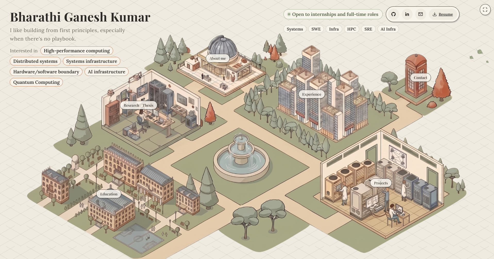

# Hi, I'm Bharathi

I'm an MS Computer Science and Software Engineering student at the University of Washington Bothell. I'm doing my thesis research on high-performance GPU systems at the [Distributed Systems Laboratory](https://depts.washington.edu/dslab/) at UW Bothell.

I like building from first principles, especially when there's no playbook.

Click the image to visit my portfolio.

## Currently

**Graduate Research Assistant, [Distributed Systems Laboratory](https://depts.washington.edu/dslab/)** | Jun 2026 – Present
Advised by [Prof. Munehiro Fukuda](https://www.uwb.edu/faculty/munehiro-fukuda/)

- Researching thesis on [MASS CUDA](https://depts.washington.edu/dslab/MASS/), a **multi-GPU agent-based modeling framework** built in **C++/CUDA**, focused on **multi-GPU communication strategies (UVA, NCCL)**, **agent collision-handling optimization**, and **per-step execution performance**
- Re-engineered MASS CUDA's **Clang-based source-to-source translator** codegen on Rocky Linux to build against **CUDA 13.2 and LLVM 21**, writing **3 benchmarks (Heat2D, GameOfLife, SugarScape)** and validating them against the new translator

**Engagement Coordinator, WiCyS (Women in Cybersecurity), UW Bothell** | Sep 2026 – Present

I run the visual side of WiCyS at UW Bothell, from recruitment posters to social media graphics. I wanted cybersecurity to feel less intimidating and more welcoming, and design turned out to be a fun way to do it. I get to experiment, give our posters some personality, and hopefully make someone curious enough to stop by and say hi.

## Selected Work

### [GPU-Cost-Aware Bin-Packing Scheduler](https://github.com/BharathiGaneshkumar/gpu-cost-aware-bin-packing-scheduler) Jul 2026

A Kubernetes admission webhook that enforces GPU cost tiers and SLA eligibility at admission time, something native Kubernetes scheduling has no way to do.

     

### [Quantum vs Classical ML on CAR T-Cell Data](https://github.com/BharathiGaneshkumar/quantum-pqk-car-t-hackathon) May 2026

Won at the UW x IBM Quantum Machine Learning Hackathon. A projected quantum kernel beat a classical SVM at predicting CAR T-cell cytotoxicity on the held-out test set.

     

### [Agentic Smart Building Maintenance System](https://github.com/BharathiGaneshkumar/agentic-bms) Oct 2026

A multi-agent system for predictive maintenance and complaint-driven fault resolution in sustainable smart buildings, built on real air handling unit data with explainable fault detection and energy-waste estimates. In progress.

         

### [Fault-Tolerant AI Inference Coordinator](https://github.com/BharathiGaneshkumar/fault-tolerant-ai-inference-coordinator) Aug 2025

A Raft consensus layer built from scratch in Go, eliminating single points of failure in AI inference request routing.

       

### [N-Body Gravitational Simulation](https://github.com/BharathiGaneshkumar/nbodyGravitationalSimulation) Feb 2026

A GPU-accelerated N-body gravitational simulator comparing sequential, OpenMP, and CUDA implementations, reaching over 100x speedup on a laptop GPU.

     

### [DawgDen](https://github.com/BharathiGaneshkumar/DawgDen) (<a href="https://dawg-den.vercel.app/">live</a>) Sep 2025

A student housing platform that reads a lease for red flags before you sign it and makes a landlord's reputation impossible to quietly erase.

        

### [Trope Chemistry](https://github.com/BharathiGaneshkumar/trope-chemistry) Jun 2026

A graph neural network for fanfiction engagement prediction, benchmarked in an ablation study against 6 other models to test whether trope structure actually beats plain text.

          

### [Causal AI: Student Success](https://github.com/BharathiGaneshkumar/studentPerformanceCausalAI) Sep 2025

A causal discovery project separating what actually drives student grades from what only correlates with them, quantified with real treatment effects.

     

### [FloodGuard AI](https://github.com/swetha7502/flood-resilience-qwen) Jul 2026

A simulated edge sensor network for flood early warning across 3 zones, staying operational through a 4-state graceful degradation ladder when the cloud drops.

        

### [OOO Negotiation Agent](https://github.com/swetha7502/ooo-agent) Jun 2026

A Slack bot where two independent agents negotiate task handoffs when someone goes out of office, instead of one bot reassigning work top-down.

   

### [ConflictMind](https://github.com/nitin-s17/conflictmind) Jun 2026

An AI agent with persistent memory that debates its own contradictory memories about you before resolving them, instead of silently overwriting one with the other.

        

## Research

- [From Attacks to Insights: XAI and Defense in Network Security](https://ieeexplore.ieee.org/document/10864205), IEEE ICSCNA 2024
- [OCULANG: Empowering Communication through Blink Language Detection](https://doi.org/10.36548/jsws.2024.4.003), IRO Journal on Sustainable Wireless Systems, 2024

## Experience

**IT Accessibility Assistant** | University of Washington Bothell | Jan 2026 – Jun 2026

- Remediated roughly **30 courses** to **WCAG 2.1 AA and ADA** standards across PDF, Word, and PowerPoint: alt text, heading hierarchy, color contrast, reading order, and table tagging. Ran **OCR** on scanned and handwritten sources first.
- **QA'd Claude-generated remediation outputs** against source documents, flagging errors and feeding structured findings back into the pipeline.
- On my own initiative, built a **web app** that logs accessibility issues by type and filter and converts them into Claude-friendly markdown, which consistently improved remediation accuracy by **30%**.

**Associate Applications Developer** | [Oracle](https://www.oracle.com/in/) | Jul 2024 – Aug 2025

[Oracle Utilities Application Framework (OUAF)](https://docs.oracle.com/en/industries/utilities/framework/264/sdk-dev-guide/index.html), Product Development and Cloud Operations

- Owned migration of an enterprise **cloud release platform serving 100+ customers** across APAC and EMEA to **independent infrastructure** end-to-end on Linux, navigating ambiguous requirements to architect **standalone SQL-based databases**, **PL/SQL application layers**, **REST APIs** and engineer **data pipeline fixes for cross-database sync failures** with no prior precedent to work from.
- Built **CI/CD and version-control pipeline from scratch** using **Liquibase changelogs** and CLI-based scripting and developer tooling, automating **Git-based promotion across 3 environments** and replacing manual, error-prone deployments with a standard workflow.
- Configured **SSO (SAML, OAuth 2.0, OIDC)** and **DB-level access control (ACL/ACE)**, coordinating with DBA and platform teams to manage security and permissions across **6+ stakeholder groups**.
- Delivered **high availability via Oracle Data Guard disaster recovery** across 3 environments, collaborating with infrastructure and DBA teams to validate setup and running **failover tests** to verify recovery behavior under failure.
- Designed and delivered **runbooks and troubleshooting guides**, along with an **18-session video training series** demonstrating strong communication skills while mentoring new team members on platform architecture and operations, adopted as the team's standard onboarding process.
- Resolved production issues across Classic and Redwood interfaces, including **60+ UI defects** through multiple rounds of code review, one of which was a **hierarchical permission bug** that required **overhauling the entire menu structure** across multiple product versions.
- Coordinated **6 master controller release cycles** on production systems hosted on **OCI** and built a **cloud cost optimization and monitoring dashboard tracking 100+ environments**, identifying idle environments and reducing unnecessary infrastructure spend.

**Applications Development Intern** | [Oracle](https://www.oracle.com/in/) | Jan 2024 – Jul 2024

- Migrated a legacy internal knowledge base to a **MoinMoin wiki** behind an **Nginx reverse proxy**, added team-level access control, and automated **broken-link detection** in Python, fixing **500+ broken links**.
- Automated **14 regression workflows** using object-oriented **Selenium and Java** test design alongside the Oracle Utilities Testing Accelerator, across 3 product versions and 9 environment instances weekly, **reducing testing time by 30%** and saving an estimated **5-6 hours of manual testing per week**.
- Resolved **60+ front-end defects** across OUAF's Classic and Redwood interfaces in JavaScript and Java.

**Associate Developer Intern** | [SAP Labs India](https://www.sap.com/india/about/labs-india.html) | May 2023 – Jul 2023

Built an **emergency financial aid disbursement application** for **17,000+ SAP Labs India employees** across 5 locations, digitizing the full insurance disbursement flow end-to-end with **TypeScript** and **REST APIs** in **Node.js and Express.js**, using **Micro Frontend architecture and Turbo Repo** on **SAP BTP**.

## Education

**M.S. Computer Science and Software Engineering** | [University of Washington, Bothell](https://www.washington.edu/) | Sep 2025 – Jun 2027

GPA 4.00 / 4.00. Coursework: High-Performance Computing, Distributed Systems, Deep Learning, Machine Learning

**B.E. Computer Science and Engineering** | [PSG College of Technology](https://www.psgtech.edu/), Coimbatore, India | Oct 2020 – May 2024

GPA 9.28 / 10.0, First Class with Distinction. Coursework: Data Structures and Algorithms, Operating Systems, Computer Networks, DBMS, Object-Oriented Programming
